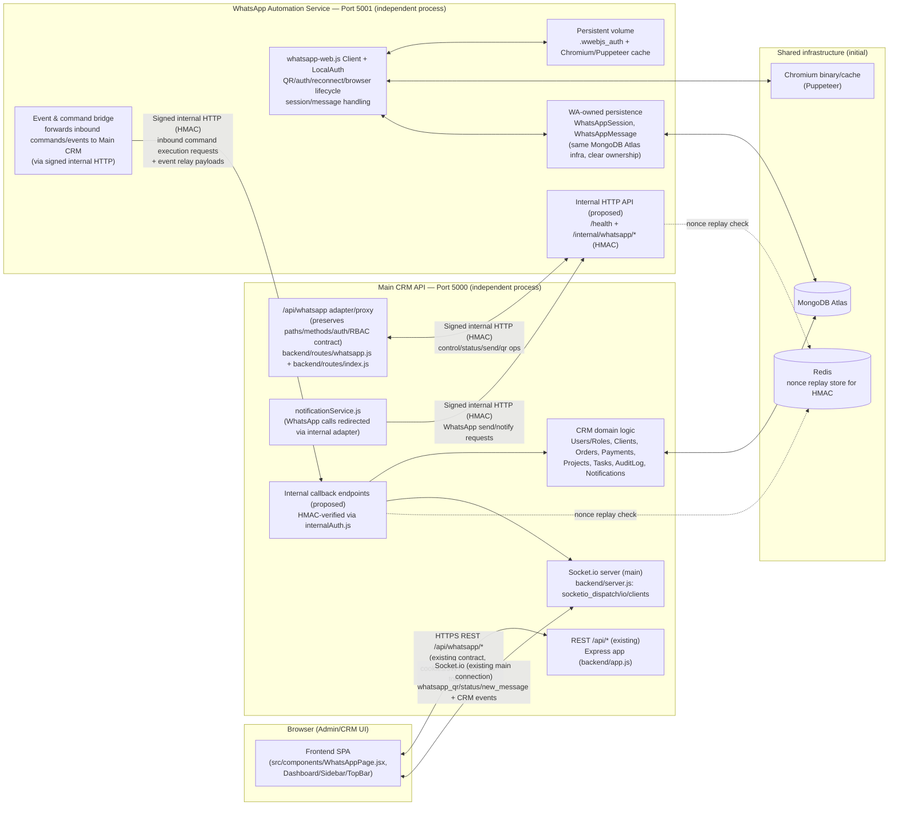
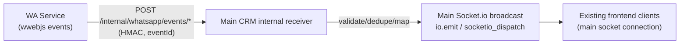

# Phase 2 / Step 2 — WhatsApp Microservice Architecture & API Contract Specification

**Project:** ViralCraft Media CRM  
**Phase:** 2 (WhatsApp extraction), Step 2 — Design specification (no implementation)  
**Status:** DRAFT — awaiting approval  
**Scope:** WhatsApp automation extraction from monolithic backend to independently hosted service  
**Authority:** Existing source code in this repository (verified by inspection). Where behavior cannot be confirmed from source, items are marked **[ASSUMPTION]** or **[UNRESOLVED]**.

**Constraints honored:** Design-only. No existing application code modified; no microservice created; no files moved/renamed; no routes/controllers/models/services/package manifests/lockfiles/env changed; no packages installed; no session credentials accessed/printed; no production DB access/modification; no commit/push/deploy. **Only this specification document is created.**

---

## 1. Architecture diagram



**Key architectural decisions**
- **Two independently deployable processes:** Main CRM (5000) and WhatsApp Automation (5001), communicating only via authenticated internal HTTP (Phase 1.1 HMAC) — no in-process coupling (`backend/server.js` currently initializes WA in-process).
- **Main CRM remains frontend/API/socket authority:** preserves existing `/api/whatsapp` contract and **existing main Socket.io connection**; WA service does not require direct frontend connectivity.
- **WA service owns transport/session mechanics:** `whatsapp-web.js`, Puppeteer/Chromium, LocalAuth, QR/connect/reconnect, browser lifecycle, WA message send/receive plumbing, WA-specific session/message operations, and forwarding to Main CRM.
- **Main CRM owns CRM business logic and domain data:** inbound WhatsApp commands (NEW PROJECT, ACCEPT/DECLINE/START/PAUSE/RESUME/DONE) are executed in Main CRM (not duplicated in WA service); Main CRM owns users/clients/orders/projects/tasks/audit logs/notifications and broadcasts frontend-facing events.
- **Same MongoDB Atlas initially, strict ownership/no dual-writer:** WhatsAppSession/WhatsAppMessage owned by WA service; domain collections owned by Main CRM (see §3). Cross-service access only through internal APIs/events, not ad-hoc dual writes.
- **Event relay model:** WA service emits connection/message lifecycle events to Main CRM over signed internal callback; Main CRM re-emits preserved Socket.io event names/payloads to frontend.
- **Failure isolation:** WA outages must not crash or block core CRM operations except where an explicit existing contract requires WA; adapters must degrade gracefully (timeouts, no infinite retries).

**Primary source references:** `backend/server.js`, `backend/routes/index.js`, `backend/routes/whatsapp.js`, `backend/services/whatsappService.js`, `backend/services/notificationService.js`, `backend/models/WhatsAppMessage.js`, `backend/models/WhatsAppSession.js`, `backend/shared/security/internalAuth.js`, `backend/shared/config/ports.js`, `backend/scripts/install-chrome.js`, `backend/scripts/puppeteer-cache.js`, `src/components/WhatsAppPage.jsx`, `render.yaml`.

---
## 2. Service responsibility matrix

| Responsibility / capability | Main CRM API (5000) | WhatsApp Automation Service (5001) | Current source evidence |
|---|---:|---:|---|
| Authentication, authorization, RBAC, CSRF (user-facing) | **Owner** | No (uses internal HMAC only) | `backend/routes/index.js` mount, `backend/middleware/*`, `backend/routes/whatsapp.js` |
| Users, roles, clients, enquiries, orders, payments | **Owner** | No domain ownership | CRM modules; WA currently reads/mutates some via `whatsappService.js` (to be decoupled) |
| Projects & tasks business logic (create/assign/state transitions) | **Owner** | No (forwards commands only) | `backend/services/whatsappService.js` (`handleAdminCommand` NEW PROJECT, `handleEmployeeCommand`, task/project/order/client mutations) |
| Audit logging (CRM actions) | **Owner** (canonical) | Reports/requests logging context via internal call; no independent domain audit ownership | `logWhatsAppAudit` -> `AuditLog` in `whatsappService.js`; `services/loggingService.js` |
| Existing frontend REST API surface (`/api/*`) | **Owner** | No direct frontend exposure | `backend/app.js`, `backend/routes/index.js` |
| Existing frontend Socket.io connection & broadcasting | **Owner** | No direct frontend socket required | `backend/server.js` Socket.io, `src/components/WhatsAppPage.jsx` connects to main |
| CRM notifications/in-app orchestration | **Owner** | Executes WA send when requested | `backend/services/notificationService.js` |
| whatsapp-web.js client, Puppeteer/Chromium runtime | No | **Owner** | `whatsappService.js`, `scripts/install-chrome.js`, `scripts/puppeteer-cache.js`, `render.yaml` |
| QR generation, WA auth/connection lifecycle, LocalAuth | No | **Owner** | `whatsappService.js` (`init`, `qr/ready/authenticated/auth_failure/disconnected`, `generateQR/reconnect/logout`) |
| Send/receive WhatsApp messages (transport) | No (requests/receives via internal API) | **Owner** | `whatsappService.js` (`sendMessage`, `message_create`, `sendAdminNotification`) |
| Reconnection & browser lifecycle, graceful shutdown | No | **Owner** | `whatsappService.js` (heartbeat, destroy/shutdown/init guards) |
| WhatsApp-specific session/message persistence ops | No (read via adapter/internal contract as needed) | **Owner** (write authority) | `WhatsAppSession`, `WhatsAppMessage` usage in `whatsappService.js`, `routes/whatsapp.js` |
| Forward inbound commands/events to Main CRM | No | **Owner** | command routing in `whatsappService.js` |
| Execute CRM command side-effects | **Owner** | No | NEW PROJECT/employee command logic in `whatsappService.js` (to be invoked in Main CRM) |
| Relay WA realtime events to frontend (preserved names) | **Owner** (broadcast) | Producer/forwarder to Main CRM | `io.emit('whatsapp_qr'|'whatsapp_status'|'whatsapp_new_message')` in `whatsappService.js` |

---
## 3. Database ownership matrix

**Initial infrastructure:** Same MongoDB Atlas cluster/infra (as today) with strict logical ownership and service boundaries. **No dual-writer behavior.** No schema changes or data moves in this design step.

| Collection / entity (Mongoose model) | Owner service | Read access | Write access | Notes / source |
|---|---|---|---|---|
| `User` (`backend/models/User.js`) | **Main CRM** | Main CRM (owner). WA service: **no direct DB access** in target state; obtains needed identity/authorization context via Main CRM internal APIs/callback context | **Main CRM only** | WA currently reads/updates user phone/cache and finds admins/employees in `whatsappService.js` — must be replaced by Main CRM lookups/decisions |
| `Client` | **Main CRM** | Main CRM; WA service none direct | **Main CRM only** | `ClientModel` used in NEW PROJECT flow (`whatsappService.js`) |
| `Order` | **Main CRM** | Main CRM; WA service none direct | **Main CRM only** | fallback `WAP-*` order in NEW PROJECT (`whatsappService.js`) |
| `Project` | **Main CRM** | Main CRM; WA service none direct | **Main CRM only** | created/updated in NEW PROJECT and assignment flow |
| `Task` | **Main CRM** | Main CRM; WA service none direct | **Main CRM only** | created/mutated in NEW PROJECT and employee commands |
| `AuditLog` | **Main CRM** | Main CRM | **Main CRM only** | `logWhatsAppAudit` currently writes `AuditLog` from WA flow; target: Main CRM records audit on command execution/callback |
| `WhatsAppSession` (`backend/models/WhatsAppSession.js`) | **WhatsApp service** | WA service (owner, read/write). Main CRM: read via WA internal status API / adapter only (no direct collection writes in target state) | **WA service only** | fields: `connected, lastConnectedAt, qrCode, phoneNumber, pushName`, timestamps |
| `WhatsAppMessage` (`backend/models/WhatsAppMessage.js`) | **WhatsApp service** | WA service (owner). Main CRM: read via WA internal messages API / adapter only | **WA service only** | fields: `from, to, body, type[in|out], timestamp`, timestamps; currently also written by `notificationService.js` and read by `routes/whatsapp.js` — to be routed through WA service |

**Preserving existing data (no move in this step):**
- Existing `WhatsAppMessage` and `WhatsAppSession` documents remain in the same MongoDB Atlas database/collections to preserve history and session metadata continuity.
- During implementation (future), WA service will be configured with access to the same DB/collections for these two entities only (principle of least privilege where feasible) or via a dedicated data-access boundary; **[UNRESOLVED]** exact credential scoping/separate DB user per service.
- A one-time “ownership cutover” is achieved operationally by disabling all Main CRM writers to these collections and routing reads/writes through WA service internal APIs — no schema migration required based on inspected schemas.
- **[ASSUMPTION]** No collection renames required; message retention/limits (e.g. current fetch `limit(100)` in `routes/whatsapp.js`) remain unchanged unless separately approved.

**Dual-writer prevention rules (target):**
- Main CRM must not create/update `WhatsAppSession`/`WhatsAppMessage` documents directly once WA service owns them.
- WA service must not mutate domain collections (User/Client/Order/Project/Task/AuditLog) directly; all domain changes occur in Main CRM via signed command/callback handling.

---
## 4. Internal API endpoint specification

### 4.1 HMAC security contract (existing — must be used as-is)

**Source:** `backend/shared/security/internalAuth.js` (Phase 1.1 hardened). **Do not invent a different format.**

| Item | Contract (as implemented) |
|---|---|
| Required headers | `x-internal-service`, `x-internal-timestamp`, `x-internal-nonce`, `x-internal-signature` (all required; missing -> 401 `INTERNAL_AUTH_HEADERS_MISSING`) |
| Secret | `INTERNAL_SERVICE_KEY` via `getInternalServiceKey()` (required in production; dev fallback exists in code — **[UNRESOLVED/RISK]** ensure production config, never log) |
| Timestamp | Unix epoch ms string; validated before accept; skew tolerance ±30,000 ms (`SKEW_TOLERANCE_MS`); expired/future/out-of-window -> 401 `INTERNAL_AUTH_TIMESTAMP_INVALID` |
| Nonce | Required, per-request unique, format `^[A-Za-z0-9._:-]{16,256}$`; signer generates `crypto.randomBytes(16).toString('hex')`; invalid/missing -> 401 `INTERNAL_AUTH_NONCE_INVALID` |
| Replay prevention | Redis atomic `SET internal:nonce:<nonce> 1 EX 60 NX` (`NONCE_TTL_SECONDS=60`); replay -> 401 `INTERNAL_AUTH_REPLAY_DETECTED`; Redis unavailable without explicit test store -> 503 `INTERNAL_AUTH_REPLAY_PROTECTION_UNAVAILABLE` (fail-closed) |
| Canonical signing message | `timestamp\nservice\nnonce\nMETHOD\ncanonicalPath\nbody` (newline-delimited). METHOD uppercased. `canonicalPath` = normalized URL path **including query string** from request target (`req.originalUrl`/provided path, URL parsing; fragments ignored). Body = raw string/buffer if provided else string/buffer else `JSON.stringify(body||{})`; `undefined/null/""/{}` normalize to `""` |
| Signature | `HMAC-SHA256(secret, canonicalMessage)` hex digest; verification uses timing-safe comparison; mismatch -> 403 `INTERNAL_AUTH_SIGNATURE_INVALID` |
| Service identity | `x-internal-service` non-empty, <=128 chars; set to `req.internalService` on success |
| Exempt paths (receiver) | `/health`, `/api/health` bypass internal auth middleware |
| Client helper | `signInternalPayload({ serviceName|service, method, path|url, body, rawBody?, timestamp?, nonce? })` (legacy shape also supported) |
| Redis dependency | `backend/config/redis.js` `safeSet/isRedisAvailable`; key prefix `internal:nonce:` |

**Operational requirements:** every internal request (both directions) must be signed with correct method + exact request path+query + exact body representation; callers must not reuse nonces; receivers must enforce verification on all non-health internal endpoints.

### 4.2 Common internal API conventions (proposed)

- **Base URLs:** Main CRM -> WA: `${WHATSAPP_SERVICE_URL}` (default `http://localhost:5001`, `backend/shared/config/ports.js`). WA -> Main CRM: `${MAIN_API_URL}` (default `http://localhost:5000`).
- **Auth:** HMAC headers on every `/internal/*` request (except health where exempt). `x-internal-service` identifies caller (e.g. `main-api`, `whatsapp-service`).
- **Content-Type:** `application/json; charset=utf-8` for JSON bodies unless noted.
- **Correlation/Idempotency (proposed, recommended):** `x-request-id` (UUID) and, for mutating/forwarded operations, `x-idempotency-key` (stable per logical operation). **[ASSUMPTION]** not present today; required for safe retries/duplicate handling.
- **Timeouts (proposed defaults):** reads/status/qr/messages 5s; actions (send/reconnect/generate-qr/logout/clear-session) 10s; command/event callbacks 15s — **[ASSUMPTION]** tune per env; must be bounded.
- **Retries (proposed):** idempotent reads: up to 2 retries with exponential backoff+jitter (e.g. 200ms, 800ms) on network/5xx/503. Non-idempotent actions: **no automatic retry** unless `x-idempotency-key`/message key proves idempotency. Never infinite retries.
- **Error envelope (proposed for internal APIs):** `{ "success": false, "error": { "code": "<STRING>", "message": "<STRING>", "statusCode": <int>, "retryable": <bool>, "details"?: any } }`; adapters must map to preserve existing public `/api/whatsapp` responses.

### 4.3 Internal endpoints — Main CRM → WhatsApp service (proposed)

| # | Method | Exact path | Calling service | Auth | Purpose / maps to current behavior |
|---|---|---|---|---|---|
| M→W1 | GET | `/internal/whatsapp/status` | Main CRM (`main-api`) | HMAC required | Connection/session + live status (backs `GET /api/whatsapp/status`, `GET /api/whatsapp/qr`) |
| M→W2 | POST | `/internal/whatsapp/generate-qr` | Main CRM | HMAC required | Trigger fresh QR/session cycle (backs `POST /api/whatsapp/generate-qr`) |
| M→W3 | POST | `/internal/whatsapp/reconnect` | Main CRM | HMAC required | Reconnect (backs `POST /api/whatsapp/reconnect`) |
| M→W4 | POST | `/internal/whatsapp/logout` | Main CRM | HMAC required | Logout/disconnect (backs `POST /api/whatsapp/logout`) |
| M→W5 | POST | `/internal/whatsapp/clear-session` | Main CRM | HMAC required | Clear session (backs `POST /api/whatsapp/clear-session`; currently same as logout behavior) |
| M→W6 | POST | `/internal/whatsapp/send` | Main CRM | HMAC required | Send WA message (backs `POST /api/whatsapp/send` and internal notification sends) |
| M→W7 | GET | `/internal/whatsapp/messages` | Main CRM | HMAC required | Fetch message history (backs `GET /api/whatsapp/messages`) |
| M→W8 | GET | `/health` | Main CRM / infra | No HMAC (health exempt pattern) | Liveness/readiness of WA service |

#### M→W1 `GET /internal/whatsapp/status`
- **Request headers:** HMAC headers; `Accept: application/json`.
- **Request body:** none.
- **Success 200:**
```json
{
  "success": true,
  "status": {
    "connected": false,
    "phoneNumber": "",
    "pushName": "",
    "lastConnectedAt": null,
    "qrCode": "",
    "lastHeartbeat": null,
    "reconnectCount": 0,
    "qrGeneratedCount": 0,
    "sessionRestored": false,
    "statusText": "DISCONNECTED",
    "isShuttingDown": false,
    "isCleanupComplete": false
  }
}
```
  - **Parity:** derived from `WhatsAppSession` + `getConnectionStatus()` as in `backend/routes/whatsapp.js` and `whatsappService.js:getConnectionStatus()` (public route currently returns subset fields; adapter preserves public shape).
- **Errors:** 401/403/503 HMAC per `internalAuth.js`; 500 `{success:false,error:{code:"WA_STATUS_FAILED",...}}`.
- **Timeout:** 5s. **Retry:** yes (idempotent). **Idempotency:** n/a.

#### M→W2 `POST /internal/whatsapp/generate-qr`
- **Body:** `{}` or empty.
- **Success 200:** `{ "success": true, "message": "QR generation triggered", "qrCode"?: "" }` (qr may arrive async via event relay; matches async behavior).
- **Errors:** 409/503 if shutting down/cannot initialize `{success:false,error:"Shutdown in progress"|"<reason>"}`; HMAC errors.
- **Timeout:** 10s. **Retry:** no by default. **Idempotency:** recommended `x-idempotency-key` to coalesce rapid repeats; treat duplicate active generation as success/no-op **[ASSUMPTION]**.

#### M→W3 `POST /internal/whatsapp/reconnect`
- **Body:** `{}`. **Success 200:** `{ "success": true, "message": "WhatsApp reconnect triggered." }`
- **Timeout:** 10s. **Retry:** no auto-retry without idempotency key. **Idempotency:** coalesce if reconnecting **[ASSUMPTION]**.

#### M→W4 `POST /internal/whatsapp/logout`
- **Body:** `{}`. **Success 200:** `{ "success": true, "message": "Logged out from WhatsApp device successfully." }`
- **Timeout:** 10s. **Retry:** no auto-retry. **Idempotency:** effectively idempotent (logged-out state).

#### M→W5 `POST /internal/whatsapp/clear-session`
- **Body:** `{}`. **Success 200:** `{ "success": true, "message": "Session cleared. Generate a new QR to link WhatsApp." }`
- **Behavior:** parity with current route calling `whatsappService.logout()` (destroy + clear session dir + re-init).
- **Timeout/Retry/Idempotency:** same as logout.

#### M→W6 `POST /internal/whatsapp/send`
- **Body:**
```json
{
  "phoneNumber": "919999999999",
  "text": "message body",
  "purpose": "manual|notification|command_reply|admin_notification",
  "idempotencyKey": "string",
  "metadata": { "source": "api|notificationService|command", "referenceId": "..." }
}
```
  - Public/manual parity validation: `phoneNumber` 10–15, `text` 1–2048 (current `routes/whatsapp.js`); notification/programmatic texts may differ in length **[UNRESOLVED]** — enforce safe max with clear error.
- **Success 200:** `{ "success": true, "data": { "_id","from","to","body","type":"out","timestamp","createdAt","updatedAt" } }` (saved `WhatsAppMessage`, mirrors `whatsappService.sendMessage()`; public `/send` wraps as `{success,message,data}`).
- **Errors:** 409/503 `{code:"WA_NOT_CONNECTED"}` when not connected (current throws -> public 500 `{error: err.message}`; adapter preserves public behavior unless separately approved), 400 validation, HMAC errors, 500 send/persist failures.
- **Timeout:** 10s. **Retry:** **no auto-retry** unless `idempotencyKey` provided and WA service guarantees dedupe of outbound send+record. **Idempotency:** required for any retried/callback-driven sends.

#### M→W7 `GET /internal/whatsapp/messages?limit=100`
- **Query:** `limit` optional (default 100, max 100 to preserve behavior).
- **Success 200:** `{ "success": true, "data": [ /* WhatsAppMessage docs, desc createdAt */ ] }`
- **Timeout:** 5s. **Retry:** yes. **Idempotency:** n/a.

### 4.4 Internal endpoints — WhatsApp service → Main CRM (proposed callbacks)

| # | Method | Exact path | Calling service | Auth | Purpose |
|---|---|---|---|---|---|
| W→M1 | POST | `/internal/whatsapp/events/connection` | WhatsApp service (`whatsapp-service`) | HMAC required | Relay connection/QR/status lifecycle events for frontend Socket.io broadcast (and any needed observation) |
| W→M2 | POST | `/internal/whatsapp/events/message` | WhatsApp service | HMAC required | Relay `whatsapp_new_message` for frontend broadcast |
| W→M3 | POST | `/internal/whatsapp/commands/inbound` | WhatsApp service | HMAC required | Forward inbound command for CRM authorization + execution and obtain reply/action result |
| W→M4 | GET | `/health` or `/api/health` | WhatsApp / infra | Exempt per receiver | Main CRM health |

#### W→M1 `POST /internal/whatsapp/events/connection`
- **Body:**
```json
{
  "event": "whatsapp_qr" | "whatsapp_status",
  "payload": { /* exact frontend-facing payload, see §7 */ },
  "occurredAt": "<ISO>",
  "eventId": "<uuid>"
}
```
- **Success 200:** `{ "success": true, "relayed": true }` (Main CRM emits to Socket.io on success).
- **Timeout:** 5s. **Retry:** yes, bounded (e.g. 3 attempts) with backoff; dedupe by `eventId`. **Idempotency:** required.

#### W→M2 `POST /internal/whatsapp/events/message`
- **Body:** `{ "event":"whatsapp_new_message", "payload": { /* WhatsAppMessage */ }, "direction":"in|out", "occurredAt":"<ISO>", "eventId":"<uuid>" }`
- **Success 200:** `{ "success": true, "relayed": true }`
- **Timeout/Retry/Idempotency:** bounded retry, dedupe by `eventId`/message `_id`.

#### W→M3 `POST /internal/whatsapp/commands/inbound`
- **Purpose:** keep CRM business logic in Main CRM.
- **Body (proposed):**
```json
{
  "commandContext": {
    "channel": "whatsapp",
    "text": "<raw message body>",
    "sender": { "waId": "<jid/raw>", "senderPhone": "<normalized>", "clientPhone": "<if known>", "fromMe": false, "isFromSelf": false },
    "messageId": "<provider unique id if available>",
    "receivedAt": "<ISO>"
  },
  "idempotencyKey": "<stable key>"
}
```
- **Success 200 (proposed):** `{ "success": true, "handled": true|false, "command": "NEW_PROJECT|ACCEPT|DECLINE|START|PAUSE|RESUME|DONE|HELP|STATUS|PROJECTS|TASKS|UNKNOWN|IGNORED", "replyText": "<string|null>", "audit": { "logged": true } }`
  - WA service sends `replyText` to WhatsApp when provided; domain events/audit performed by Main CRM. **[ASSUMPTION]** exact response shape finalized in implementation but must support all current replies/side-effects.
- **Timeout:** 15s. **Retry:** bounded, only with stable `idempotencyKey` and idempotent handlers. **Idempotency:** mandatory to prevent duplicate mutations.

### 4.5 Preserved public (frontend-facing) API contract — `/api/whatsapp` (Main CRM adapter)

**Mounting:** `backend/routes/index.js` -> `router.use('/whatsapp', protect, authorize('SUPER_ADMIN'), whatsappRoutes)` (effective global SUPER_ADMIN). **Route-level declarations in `backend/routes/whatsapp.js` include MANAGER for status/qr/messages/inbound, but parent mount restricts effectively — this effective behavior MUST be preserved** (see §8).

| Method | Exact path | Effective auth (current) | Current request/response (must preserve) | Source |
|---|---|---|---|---|
| GET | `/api/whatsapp/status` | SUPER_ADMIN (effective) | 200 `{success, connected, phoneNumber, pushName, lastConnectedAt, qrCode, lastHeartbeat, reconnectCount, qrGeneratedCount, sessionRestored}` | `backend/routes/whatsapp.js` |
| GET | `/api/whatsapp/qr` | SUPER_ADMIN (effective) | 200 `{success, qrCode}` | `backend/routes/whatsapp.js` |
| POST | `/api/whatsapp/send` | SUPER_ADMIN + `webhookLimiter` + validation | Body `{phoneNumber(10-15), text(1-2048)}`; 200 `{success, message, data:savedMsg}`; 400 `{error:'Validation failed', details}`; 500 `{error: err.message}` | `backend/routes/whatsapp.js` |
| POST | `/api/whatsapp/logout` | SUPER_ADMIN (effective) | 200 `{success, message:'Logged out from WhatsApp device successfully.'}` | `backend/routes/whatsapp.js` |
| POST | `/api/whatsapp/generate-qr` | SUPER_ADMIN (effective) | 200 `{success, message:'QR code generation triggered. Scan with WhatsApp to link.'}` or 500 `{error}` | `backend/routes/whatsapp.js` |
| POST | `/api/whatsapp/reconnect` | SUPER_ADMIN (effective) | 200 `{success, message:'WhatsApp reconnect triggered.'}` | `backend/routes/whatsapp.js` |
| POST | `/api/whatsapp/clear-session` | SUPER_ADMIN (effective) | 200 `{success, message:'Session cleared. Generate a new QR to link WhatsApp.'}` | `backend/routes/whatsapp.js` |
| GET | `/api/whatsapp/messages` | SUPER_ADMIN (effective) | 200 `{success, data:[...last 100 WhatsAppMessage desc createdAt...]}` | `backend/routes/whatsapp.js` |
| POST | `/api/whatsapp/inbound` | SUPER_ADMIN (effective) + validation | Body `{text(required), senderPhone? default '919440720814'}`; 200 `{success, message:'Inbound WhatsApp command processed successfully.'}`; 400 validation; errors via `next(err)` | `backend/routes/whatsapp.js` |

---
## 5. Inbound command flow diagrams

**Design principle:** WA service performs transport, message normalization, and sender metadata capture; **Main CRM performs sender identification/authorization, all CRM data mutations, audit logging, in-app/staff notifications, and domain event emission**. WA service sends the WhatsApp reply returned by Main CRM. Idempotency keys must prevent duplicate side effects on retries/re-deliveries.

```mermaid
sequenceDiagram
    autonumber
    participant U as WhatsApp User (Admin/Employee)
    participant WA as WA Service (wwebjs)
    participant CRM as Main CRM (5000)
    participant DB as MongoDB (domain owned by CRM)
    participant SIO as Main Socket.io (frontend)

    U->>WA: WhatsApp message_create
    WA->>WA: Filter groups/status/broadcast; normalize phone; persist inbound WhatsAppMessage; emit relay event
    WA->>CRM: POST /internal/whatsapp/commands/inbound (HMAC, idempotencyKey)
    CRM->>CRM: Identify sender & authorize (User/role/status/phone match)
    alt Authorized & command handled
      CRM->>DB: Execute CRM mutations (idempotent)
      CRM->>DB: Write AuditLog / trigger notifications (as applicable)
      CRM->>SIO: Emit domain/dashboard events (if applicable)
      CRM-->>WA: 200 {handled, command, replyText, ...}
      WA-->>U: msg.reply(replyText) / send response
    else Ignored / unauthorized / unknown
      CRM-->>WA: 200 {handled:false|IGNORED|UNKNOWN, replyText?}
      WA-->>U: optional reply (per current behavior)
    end
```

### 5.1 Super Admin command — `NEW PROJECT`

**Current implementation:** `parseNewProjectMessage`, `parseDateString`, `mapCategory`, and NEW PROJECT branch in `handleAdminCommand`; `sendTaskNotification(projectObj._id, [])`; socket emits; audit — `backend/services/whatsappService.js` (parser/command handling, project/client/order/task creation, emits).

| Aspect | Specification (grounded in source) |
|---|---|
| Expected message format | Text (markdown stripped in handler) where uppercased content starts with `NEW PROJECT`. Parsed key/value tokens (case-insensitive keys, `key: value`, optional `*`, supports `|` splits/newlines): `client`, `project`/`project name`, `department`/`dept`, `deadline`/`due`/`due date`, `drive`/`drive url`/`drive link`/`drive folder`/`link`/`url`, `priority`, `editors`, `notes`/`description`. On parse/validation failure current flow replies with template prompting these fields. |
| Sender identification | WA service forwards sender WA identifiers/normalized phone/fromMe/self flags to Main CRM. Main CRM authoritatively resolves active user by normalized phone/role/status (admin/self-originated routing in current `message_create`/`handleAdminCommand` context). |
| Authorization checks | Permitted only for authorized active SUPER_ADMIN/admin-originated context per current behavior; Main CRM enforces role/status checks. |
| Main CRM endpoint/handler (proposed) | `POST /internal/whatsapp/commands/inbound` -> Main CRM WhatsApp-command handler implementing current NEW PROJECT logic (extracted from `whatsappService.js`, executed in Main CRM). |
| Database changes (preserve behavior) | Find/create `Client` by case-insensitive name (else create with placeholder phone/notes `Auto-created via WhatsApp command`); create fallback `Order` (`orderId: WAP-<hex>`, amount 0, paymentStatus `success`, status `processing`, linked client/project); create `Project` (category mapped, department, priority normalized low/medium/high default medium, description from notes, estimatedCompletion parsed, status `pending`, createdBy admin, source `WhatsApp`, editors, driveShareableLink); generate 8 default `Task`s (`Raw Footage, Assembly Edit, Color Grading, Audio Cleanup, Motion Graphics, Thumbnail, Quality Check, Final Delivery`) with order-based taskIds/priority/deadline/pending; match active EMPLOYEE users by department heuristics and assign project.employees/assignments, set project status `in_progress`, assign initial tasks to matched employees; save/link order.project. |
| Audit logging | `logWhatsAppAudit(adminUser, senderPhone, 'NEW PROJECT', 'PROJECT_CREATED', projectObj._id, null, 'Success')` on success (and failure/error audit as applicable) — **Main CRM writes AuditLog**. |
| Notifications | Triggers project assignment notifications (`sendTaskNotification` -> `sendProjectAssignmentNotifications`) which performs in-app notifications, optional employee emails, and WhatsApp sends per current logic; WA replies/transport via WA service; preserve non-blocking/error-handling semantics (currently errors caught/logged). |
| WhatsApp reply | Success: confirmation including project/client/department/priority/deadline/employees assigned/tasks generated. Validation/parse failure: template/help reply. Exception: `Project creation failed: <err.message>` (current pattern). |
| Idempotency & duplicate handling | Existing: duplicate project name (escaped/ci) created within last 60s rejected with “already created recently. Skipping duplicate request.” Preserve and strengthen with internal `idempotencyKey` to guard retries. |
| Failure responses | Validation -> guidance reply (no create). Processing error -> controlled error reply; callback returns safe handled/error result. |

### 5.2 Employee commands — `ACCEPT`, `DECLINE`, `START`, `PAUSE`, `RESUME`, `DONE`

**Current implementation:** `handleEmployeeCommand` in `backend/services/whatsappService.js`.

| Aspect | Specification (grounded in source) |
|---|---|
| Expected message format | First uppercased token is command: `ACCEPT [taskId?]`, `DECLINE [taskId?]`, `START [taskId?]`, `PAUSE [taskId?]`, `RESUME [taskId?]`, `DONE [taskId?]`. Optional taskId matched to tasks assigned to employee (exact or suffix/ci). If omitted, fallback task selected by status/recency per command (e.g. latest `assigned` for ACCEPT/DECLINE; accepted/assigned for START/RESUME; `in_progress` for PAUSE; accepted/in_progress/assigned for DONE). |
| Sender identification | Normalized sender phone matched to active EMPLOYEE user (routing/identity context forwarded by WA service; Main CRM authoritative). |
| Authorization checks | Only matched active employee (assignee) may act; task lookup scoped to `assignedTo: employeeUser._id` — preserve strict scoping. |
| Main CRM endpoint/handler (proposed) | `POST /internal/whatsapp/commands/inbound` -> Main CRM employee-task command handler. |
| Database changes (preserve behavior) | **ACCEPT:** status `accepted`, set `acceptedAt`, add comment, save. **DECLINE:** status `pending`, clear `assignedTo`, add comment, save. **START/RESUME:** status `in_progress`, push timeTracking start, add comment, save. **PAUSE:** requires `in_progress`; compute elapsed since last start, update `actualHours`, push pause timeTracking with elapsedMs, status `accepted`, add comment, save. **DONE:** compute elapsed since last start if any, update `actualHours`, status `completed`, set `completedAt`, push complete timeTracking, add comment, save. |
| Audit logging | `logWhatsAppAudit(...)` per command/action/task/project — Main CRM writes. |
| Notifications | `sendAdminNotification(...)` per command and `notifyStaff(...)` with command-specific titles/messages/types (current dispatcher pattern) — preserve outcomes; WA transport via WA service adapter. |
| WhatsApp reply | Command-specific success confirmations and not-found replies as in current implementation; unsupported employee command -> `Commands available for Employees: ACCEPT, DECLINE, START, PAUSE, RESUME, DONE.` |
| Realtime events | Main CRM emits on main Socket.io: `Dashboard Updated` and `dashboard-update` with `{ taskId, employeeId }` for ACCEPT/START/RESUME/PAUSE/DONE and `{ taskId: originalId }` for DECLINE (preserve payloads). |
| Idempotency & duplicate handling | **[GAP in current impl]** no explicit message-id/idempotency guard observed; duplicates can repeat transitions/comments/notifications. Target requires `idempotencyKey` and idempotent handlers (detect already-applied state, no-op + stable reply). |
| Failure responses | Controlled not-found/invalid replies; on processing error, avoid partial duplicate side effects under idempotent execution. |

---
## 6. Realtime event architecture

**Requirement:** Frontend continues using **existing Main CRM Socket.io connection**. WA service forwards events to Main CRM; Main CRM broadcasts to frontend. WA service must not be a required direct frontend socket endpoint.

### 6.1 Preserved WhatsApp event names and payloads (verified)

| Event name | Emitted today from | Current payload (source) | Trigger(s) |
|---|---|---|---|
| `whatsapp_qr` | `backend/services/whatsappService.js` (qr handler) | `{ qrCode: <dataURL string> }` | QR generated / scan required |
| `whatsapp_status` | `whatsappService.js` (qr/ready/auth_failure/disconnected/init-fail/logout paths) | **Connected:** `{ connected: true, statusText: 'CONNECTED', phoneNumber: <string>, pushName: <string>, lastConnectedAt: <Date/value> }`. **Disconnected:** `{ connected: false, statusText: 'DISCONNECTED' }`. **Disconnected w/ error:** `{ connected: false, statusText: 'DISCONNECTED', error: <msg> }` | Ready, disconnect, auth failure, QR pending, init/logout/reconnect transitions |
| `whatsapp_new_message` | `whatsappService.js` (inbound persist, sendMessage, sendAdminNotification) | Saved `WhatsAppMessage` document/object `{ from, to, body, type: 'in'|'out', timestamp, _id?, createdAt?, updatedAt? }` | Inbound/outbound message recorded |

### 6.2 CRM/domain events currently emitted by WhatsApp command handlers (verified)

| Event name(s) | Payload (source) | Trigger |
|---|---|---|
| `Project Created` and `project-created` | `projectObj` (created Project) | NEW PROJECT success |
| `Task Created` and `task-created` | `tk` (each created Task) | NEW PROJECT success, per default task |
| `Dashboard Updated` and `dashboard-update` | `{ projectId: projectObj._id }` | NEW PROJECT success |
| `Dashboard Updated` and `dashboard-update` | `{ taskId: task._id, employeeId: employeeUser._id }` | Employee ACCEPT / START / RESUME / PAUSE / DONE |
| `Dashboard Updated` and `dashboard-update` | `{ taskId: originalId }` | Employee DECLINE |

**Source:** `backend/services/whatsappService.js` `io.emit(...)` calls in NEW PROJECT and employee command paths (and WA status/message emits).

### 6.3 Relay flow (target)



- **Main CRM:** verify HMAC, dedupe by `eventId`, map to exact event names/payloads, emit on existing Socket.io server.
- **WA service:** capture source events, forward reliably with bounded retries; no direct frontend socket required.
- **Preferred:** Main CRM emits domain events (`Project/Task/Dashboard`) locally when executing commands (guarantees parity/ordering with DB commits); WA relays WA-transport events (`whatsapp_qr/status/new_message`). **[UNRESOLVED]** final split to be locked in implementation but must preserve observable behavior.

---
## 7. Frontend compatibility mapping

**No frontend code changes in this step.** Main CRM must act as proxy/adapter to WA service while preserving contract.

| Frontend integration point | Current call/listener (source) | Backend today | Target (same external contract) | Parity notes |
|---|---|---|---|---|
| Status fetch | `axios.get('/api/whatsapp/status')` (`src/components/WhatsAppPage.jsx`) | `routes/whatsapp.js` -> session + `getConnectionStatus()` | Adapter -> `GET /internal/whatsapp/status` | Preserve fields/semantics |
| Messages fetch | `axios.get('/api/whatsapp/messages')` | `WhatsAppMessage.find().sort({createdAt:-1}).limit(100)` | Adapter -> `GET /internal/whatsapp/messages` | Preserve `{success,data}`, order/limit |
| Generate QR | `axios.post('/api/whatsapp/generate-qr')` | `whatsappService.generateQR()` | Adapter -> `POST /internal/whatsapp/generate-qr` | Preserve messages/status |
| Reconnect | `axios.post('/api/whatsapp/reconnect')` | `whatsappService.reconnect()` | Adapter -> `POST /internal/whatsapp/reconnect` | Preserve |
| Logout | `axios.post('/api/whatsapp/logout')` | `whatsappService.logout()` | Adapter -> `POST /internal/whatsapp/logout` | Preserve |
| Clear session | `axios.post('/api/whatsapp/clear-session')` | `whatsappService.logout()` | Adapter -> `POST /internal/whatsapp/clear-session` | Preserve |
| Socket events | `socket.on('whatsapp_qr'|'whatsapp_status'|'whatsapp_new_message')` on main socket | Emitted by in-process WA service on main `io` | Main CRM re-emits relayed events on same main Socket.io | No direct WA service socket |
| Access/UI gating | Dashboard/Sidebar/TopBar WhatsApp tab; UI access includes SUPER_ADMIN/MANAGER | `routes/index.js` + `routes/whatsapp.js` | Preserve effective backend behavior and existing UI behavior | RBAC note below |
| Notification routing | `src/utils/notificationTarget.js` includes `whatsapp` | n/a | unchanged | no WA endpoint dependency |

**RBAC & validation preservation (explicit):**
- **Current effective behavior:** `/api/whatsapp` mounted with `protect, authorize('SUPER_ADMIN')` in `backend/routes/index.js` — **all** WhatsApp API routes are effectively SUPER_ADMIN-only regardless of per-route `authorize('SUPER_ADMIN','MANAGER')` declarations in `backend/routes/whatsapp.js` (status/qr/messages/inbound). **This effective restriction MUST be preserved** unless a separate, explicitly approved security/product change is made.
- Preserve validators/rate limiting: `POST /send` uses `webhookLimiter` and `express-validator` (phoneNumber 10–15, text 1–2048); `POST /inbound` validates `text` required and accepts `senderPhone` default `919440720814`.
- Preserve HTTP methods, paths, request/response JSON structures, and error shapes/status codes as in §4.5.
- **[UNRESOLVED/INTENT CHECK]** Route-level MANAGER allowances suggest possible intent for read access but are overridden by mount today; clarifying/changing this is out of scope.

---
## 8. Notification-service migration plan

**Current coupling (source):** `backend/services/notificationService.js` dynamically imports `whatsappService` and `WhatsAppMessage`, sends WhatsApp messages for project assignments and persists outbound `WhatsAppMessage` records; `whatsappService.sendTaskNotification` delegates to `sendProjectAssignmentNotifications(projectId)`; WA command flows can trigger this.

### 8.1 Preserve existing helper contracts (required)

| Helper (export/contract) | Current signature/behavior | Current usage (verified) | Migration approach |
|---|---|---|---|
| `sendEnquiryWhatsAppNotification` | `({ customerName, phone, email, selectedService, projectDescription, budget, orderId })` -> formats admin text, sends via `sendAdminNotification`, catches/logs | Exported in `backend/services/whatsappService.js`; no import/call sites found in repo scan (**preserve regardless**) | Keep same name/signature/return semantics in Main CRM WA adapter; call WA internal send (admin notification) via HMAC; preserve non-fatal logging |
| `sendOrderConfirmationWhatsApp` | `(clientName, clientPhone, orderId, clipCount, amount)` -> `sendMessage`, catches/logs | Exported in `whatsappService.js`; imported in `backend/controllers/taskController.js` (no call sites found) | Preserve contract; route through internal send |
| `sendOrderCompletedWhatsApp` | `(clientName, clientPhone, orderId, deliveryLink)` -> `sendMessage`, catches/logs | Exported in `whatsappService.js`; imported in `backend/controllers/taskController.js` (no call sites found) | Preserve contract; route through internal send |
| `sendTaskNotification` | `(projectId, employeeIds)` -> calls `sendProjectAssignmentNotifications(projectId)` (employeeIds currently unused), catches/logs | Used internally by `whatsappService.js` (NEW PROJECT) and exported; imported in `taskController.js` (no call sites found) | Preserve signature/behavior; in Main CRM invoke local `sendProjectAssignmentNotifications` which uses WA adapter for transport (acyclic) |

### 8.2 Target integration design

- Add **Main CRM → WA internal client/adapter** (replacing in-process `whatsappService` usage) for HMAC signing (`signInternalPayload`), bounded timeouts, limited retries for idempotent ops, idempotency keys for sends, and response/error mapping.
- `notificationService.js` must stop importing `whatsappService`/`WhatsAppMessage` directly. WA delivery becomes: build message -> call WA internal send API -> WA service persists outbound `WhatsAppMessage` and emits `whatsapp_new_message` (single writer). Remove duplicate Main CRM writes of `WhatsAppMessage`.
- **Prevent circular dependencies/recursion:** WA service must not call back into `sendTaskNotification`/`sendProjectAssignmentNotifications` in a way that loops (`WA -> CRM -> WA -> CRM`). Preferred: NEW PROJECT executed in Main CRM triggers notifications locally; WA service handles transport/replies only.
- **Duplicate prevention:** propagate `idempotencyKey` (e.g. `projectId+recipient+purpose`) for WA sends; make notification orchestration idempotent where feasible.

### 8.3 WhatsApp unavailable behavior (core CRM must not fail)

| Scenario | Required behavior |
|---|---|
| WA service offline/timeout/5xx on send | Helper/send fails gracefully: log error, return failure/undefined consistent with current catch-and-log behavior; **do not break core CRM operations** |
| WA not connected (`WA_NOT_CONNECTED`) | Same non-fatal handling; status surfaced via existing status endpoints when available |
| `/api/whatsapp/send` manual API when WA unavailable | Preserve current API error behavior (currently 500 `{error: err.message}` when send throws) — **[ASSUMPTION]** acceptable; Main CRM must not crash |
| Message history/status fetch when WA unavailable | Adapter returns controlled 503/502 or safe mapped error; frontend handles as today |
| Existing business contract requires WA | None identified as hard-fail for core domain operations (helpers catch/log). **[UNRESOLVED]** confirm if any SLA requires guaranteed delivery |

---
## 9. Session and hosting architecture

| Requirement | Specification / source evidence |
|---|---|
| Independent deployable process | WA service runs on port 5001 (`backend/shared/config/ports.js`), separate lifecycle from Main CRM 5000 |
| Persistent volume for auth/session | **Required:** persistent writable volume for `.wwebjs_auth/` (LocalAuth `clientId: 'vcm-crm-whatsapp'` in `whatsappService.js`). Session dir may be cleared on auth_failure/disconnect/logout/generateQR flows by design, but must persist across restarts/deploys for restore |
| LocalAuth/session path correctness | Consistent working directory and permissions so `LocalAuth` can create/read `session-vcm-crm-whatsapp`; avoid ephemeral paths |
| Chromium/Puppeteer cache | Persistent or reliably available in production. `render.yaml`: `PUPPETEER_CACHE_DIR=/opt/render/project/src/backend/.cache/puppeteer`; build `npm ci && npm run setup:chrome` using `backend/scripts/install-chrome.js`, `backend/scripts/puppeteer-cache.js` |
| Chrome install/build process | Build-time install+verify only (`setup:chrome`, postinstall) — never at server start/per connection. Chrome revision must match Puppeteer/whatsapp-web.js |
| Environment variables (relevant) | `NODE_ENV`, `PORT`/`WHATSAPP_PORT`, `WHATSAPP_SERVICE_URL`/`MAIN_API_URL`, `INTERNAL_SERVICE_KEY` (prod required), `MONGO_URI` (if WA owns WA collections), `REDIS_URL` (nonce replay on receivers), `PUPPETEER_CACHE_DIR`, `PUPPETEER_EXECUTABLE_PATH` (optional, if file exists), `ADMIN_WHATSAPP_NUMBER` fallback — **[UNRESOLVED]** finalize full WA-service `.env` inventory at implementation |
| Memory/CPU | Headless Chromium is resource intensive; allocate sufficient RAM/CPU and avoid competing browser workloads. **[ASSUMPTION]** size via load testing |
| Single active browser/session holder | **Mandatory:** exactly one running instance holds the WA account session/browser (no horizontal scaling for same account). Use single replica/leader lock/affinity; `takeoverOnConflict: true` can disrupt if duplicated |
| Graceful shutdown | Handle SIGTERM/SIGINT: stop heartbeats/intervals, await in-flight init (bounded), destroy tracked clients, close server/DB cleanly (current `shutdown()` semantics in `whatsappService.js`) |
| Restart & reconnection behavior | Restore LocalAuth session on restart if present; if disconnected/auth lost, generate QR and emit status/QR events. Preserve heartbeat/QR-expiry/reconnect logic with non-fatal isolation |

---
## 10. Failure-handling strategy

| Failure scenario | Detection / source context | Expected system behavior | Retry / idempotency | User/ops impact |
|---|---|---|---|---|
| WhatsApp service offline/unreachable | Connect/timeout/5xx from Main CRM adapter | Main CRM returns controlled errors for WA-dependent calls; **core CRM operations continue**; frontend shows status/error states | Bounded retries for idempotent reads only; no infinite retries | WA features degraded; no CRM outage |
| Main CRM API offline | WA->CRM callback fails | WA service must not crash; retry events/commands with bounded backoff and buffering where possible **[ASSUMPTION]**; avoid unbounded memory growth | Bounded retries with `eventId`/`idempotencyKey`; DLQ/log after max attempts **[ASSUMPTION]** | Relay/command side-effects delayed |
| MongoDB unavailable | DB errors in WA or Main CRM | Fail affected ops with 503/500; no silent data loss; preserve liveness if possible | No tight-loop retries; limited backoff per client config **[ASSUMPTION]** | Affected reads/writes fail |
| Redis unavailable (HMAC nonce store) | `internalAuth.js` fail-closed -> 503 `INTERNAL_AUTH_REPLAY_PROTECTION_UNAVAILABLE` | Reject internal requests requiring replay protection; do not bypass | Retry after recovery; do not auto-disable security | Inter-service calls blocked until healthy |
| HMAC authentication fails | 401/403/500 from `internalAuth.js` | Reject request; log safely without secrets/signatures; no side effects | No retry on 401/403; investigate config on 500 | Call denied (config/clock/tamper) |
| Internal request times out | HTTP client timeout | Treat as failure; mutating ops require idempotency key before retry | Retry only if idempotent and within budget | Possible delayed/ambiguous completion |
| Inbound message processed twice | Redelivery/retry after timeout | Dedupe by stable idempotency key; handlers must be idempotent (no duplicate mutations/notifications/sends) | Mandatory idempotency; duplicates return safe/prior result | Prevents duplicate business actions |
| WhatsApp disconnects | `disconnected` event in `whatsappService.js` | Update status, emit `whatsapp_status`, controlled re-init/reconnect; preserve session handling | Bounded reconnect/backoff; avoid infinite tight loops **[ASSUMPTION]** | Temporary WA unavailability / QR may be needed |
| Chromium crashes / browser launch fails | Puppeteer/wwebjs/init errors | Cleanup client, mark disconnected, emit error status, allow re-init/generate-QR; do not crash process | Controlled client restart; alerting recommended **[ASSUMPTION]** | WA automation interrupted |
| Session storage lost/corrupt or volume missing | LocalAuth restore fails/cleared state | Treat as unauthenticated; require new QR scan | N/A | Re-authentication required |
| Event forwarding fails (WA -> Main CRM) | Callback timeout/5xx/network | Buffer/retry with bounded attempts and `eventId` dedupe; log for reconciliation if exhausted **[ASSUMPTION]** | Bounded + jitter; idempotent consumers | Possible missed transient realtime events (recoverable via polling) |

**Cross-cutting:** no unlimited retries; no duplicate WA delivery on retry without dedupe; structured logging without secrets/tokens/session data; circuit-breaking/backpressure **[ASSUMPTION]** for repeated failures.

---
## 11. Migration sequence

| Step | Action | Key verification / exit criteria | Notes |
|---|---|---|---|
| 1 | **Create standalone WhatsApp service (no traffic switch)** | Boots on 5001 with `/health`; independent deploy/build; Main CRM runtime behavior unchanged | Port WA runtime/scripts/config boundaries per approved design |
| 2 | **Verify independent QR generation and connection** | generate-qr/status works against WA service; `whatsapp_qr`/`whatsapp_status` produced correctly | Persistent volume mounted |
| 3 | **Verify session persistence after restart** | Restart restores LocalAuth session without mandatory re-scan when valid | Validates `.wwebjs_auth` + cache persistence |
| 4 | **Implement authenticated Main CRM ↔ WhatsApp communication** | HMAC-signed internal calls succeed; nonce replay/timestamp/method-path-body enforced per `internalAuth.js`; failures handled gracefully | Redis and `INTERNAL_SERVICE_KEY` configured |
| 5 | **Preserve inbound command behavior** | NEW PROJECT and ACCEPT/DECLINE/START/PAUSE/RESUME/DONE produce identical mutations, replies, audits, notifications, events (idempotent) | CRM logic executed in Main CRM |
| 6 | **Implement realtime event relay** | Frontend (main socket) receives `whatsapp_qr`, `whatsapp_status`, `whatsapp_new_message` and CRM events with preserved payloads | Main CRM remains broadcaster |
| 7 | **Convert Main CRM WhatsApp routes into adapter** | `/api/whatsapp/*` parity: paths/methods/effective auth+RBAC/validation/rate-limit/request-response confirmed | `WhatsAppPage.jsx` unchanged |
| 8 | **Decouple notificationService** | WA sends via internal adapter; no direct WA transport/model writes from Main CRM notification flow; helpers preserved; no circular deps/duplicates | Regression on assignments/helpers |
| 9 | **Run full regression tests** | Automated + manual checks for WA and non-WA critical CRM paths; include WA-down failure isolation | Auth/RBAC/projects/tasks/orders/payments/notifications/sockets |
| 10 | **Staged traffic cutover** | Route production `/api/whatsapp` traffic to adapter-backed WA service; monitor errors/latency/session stability | Feature flag/config switch recommended **[ASSUMPTION]** |
| 11 | **Retain documented rollback path until stable** | Ability to revert routing/behavior quickly; keep legacy runtime available but inactive during stabilization | See §12 |
| 12 | **Remove old in-process WA runtime only after successful verification** | Post-stability cleanup of legacy in-process initialization and dead code | **Do not remove prematurely** |

---
## 12. Rollback strategy

- **Trigger conditions:** sustained WA send/receive failures, session instability/QR loops, command correctness regressions, HMAC/internal integration faults, unacceptable latency/error rates, or data consistency risks.
- **Rollback action (staged window):** revert Main CRM `/api/whatsapp` adapter routing and WA-callback/event-relay integration to the previous stable configuration; if the legacy in-process WA runtime is retained during stabilization, re-enable it under controlled config/feature flag. **Do not run dual active writers** for `WhatsAppSession/WhatsAppMessage` or duplicate command executors simultaneously.
- **Data integrity:** no schema changes in this phase; preserve existing collections and records. Any rollback must ensure a single source of truth for session/message writes and command execution.
- **Operational steps:** disable cutover flag/routing -> verify Main CRM health and frontend `/api/whatsapp` behavior -> confirm no duplicate background processors -> monitor sessions/events -> perform root-cause fix before reattempt.
- **Post-rollback validation:** QR/connect, status/messages, inbound commands, notifications, and realtime events match pre-cutover behavior.
- **Exit:** legacy in-process WA runtime removed only after sustained stable operation and explicit approval.

---
## 13. Acceptance criteria

1. **Architecture & deployment:** Main CRM (5000) and WhatsApp service (5001) run as independent, separately deployable processes with no in-process WA client in Main CRM post-cutover.
2. **API compatibility:** All existing `/api/whatsapp` endpoints preserve path, method, request/response structure, validation, rate limiting, and **effective** auth/RBAC behavior; `src/components/WhatsAppPage.jsx` works without frontend code changes.
3. **Realtime parity:** Frontend continues using existing Main CRM Socket.io connection and receives `whatsapp_qr`, `whatsapp_status`, `whatsapp_new_message` and verified CRM events (`Project Created`/`project-created`, `Task Created`/`task-created`, `Dashboard Updated`/`dashboard-update`) with equivalent payload semantics.
4. **Security:** All Main CRM ↔ WA service internal communication uses existing Phase 1.1 HMAC contract (`backend/shared/security/internalAuth.js`) including timestamp skew, nonce replay prevention (Redis-backed atomic NX), and method/path/body binding; no unauthenticated internal endpoints exposed.
5. **Command correctness:** NEW PROJECT and employee ACCEPT/DECLINE/START/PAUSE/RESUME/DONE produce identical CRM mutations, audit records, notifications, replies, and events; CRM business logic executes only in Main CRM.
6. **Idempotency & reliability:** Duplicate/retried inbound processing and internal retries do not create duplicate projects/tasks/messages/notifications; timeouts and retries are bounded.
7. **Ownership boundaries:** `WhatsAppSession`/`WhatsAppMessage` written only by WA service; domain collections (User/Client/Order/Project/Task/AuditLog) written only by Main CRM; no dual-writer behavior.
8. **Notification integration:** Helpers `sendEnquiryWhatsAppNotification`, `sendOrderConfirmationWhatsApp`, `sendOrderCompletedWhatsApp`, `sendTaskNotification` remain available with compatible contracts; `notificationService` uses internal WA adapter with no circular dependencies.
9. **Session/hosting:** Persistent `.wwebjs_auth` volume, correct LocalAuth client (`vcm-crm-whatsapp`), reliable Chromium/Puppeteer cache/build (`PUPPETEER_CACHE_DIR`, build-time install), single active session holder, and graceful shutdown/reconnect behavior.
10. **Failure isolation:** WA service outages/degradation do not crash Main CRM or block unrelated core CRM operations; failures return controlled errors and are observable.
11. **Rollback:** Documented and tested rollback path exists; legacy in-process runtime removed only after sustained stable verification and approval.

---
## 14. Assumptions and unresolved questions

| ID | Type | Item | Impact |
|---|---|---|---|
| A1 | Assumption | Internal endpoint paths/naming under `/internal/whatsapp/*` and callback routes on Main CRM are proposed and may be adjusted if consistent and HMAC-protected | Contract finalization |
| A2 | Assumption | `x-request-id` / `x-idempotency-key` headers and `eventId` dedupe storage are added for reliability (not present today) | Safe retries/duplicate prevention |
| A3 | Assumption | WA service has bounded retry queue/buffering for callbacks when Main CRM is temporarily unavailable | Prevents loss of relayed events/commands |
| A4 | Assumption | Single-replica deployment (or strict leader election) for WA service per WhatsApp account | Prevents session conflicts/browser contention |
| U1 | Unresolved | Exact DB credential scoping/separation for WA service access limited to `WhatsAppSession`/`WhatsAppMessage` in shared Atlas | Least-privilege hardening |
| U2 | Unresolved | Final max length/validation policy for notification/programmatic WA texts vs public `/send` 2048-char limit | API/adapter validation behavior |
| U3 | Unresolved | Whether `/api/whatsapp/inbound` test endpoint executes via Main CRM command handler (recommended) and remains effectively SUPER_ADMIN-only as today | Behavior parity/intent |
| U4 | Unresolved | Any external/hidden consumers of currently-unused exported WA helpers (must preserve exports regardless) | Compatibility |
| U5 | Unresolved | Cutover mechanism (feature flag/config toggle) and observability/alerting thresholds (health, queue depth, callback failures) | Operational rollout/rollback |
| U6 | Unresolved | Guaranteed delivery/reconciliation if WA->CRM relay exhausts retries (polling recovers state; command callbacks need stronger guarantees) | Reliability/consistency |
| U7 | Unresolved | Intent vs effective RBAC mismatch: route-level MANAGER allowances exist but are overridden by SUPER_ADMIN mount in `routes/index.js` | Must preserve effective behavior now; clarify separately |

---
## 15. Risks discovered

| Risk | Severity | Description | Mitigation (design) |
|---|---|---|---|
| Command duplication / non-idempotent side effects | High | Current inbound handlers lack explicit idempotency keys; retries/timeouts can duplicate Project/Task creation, state changes, comments, notifications | Mandatory `idempotencyKey` + idempotent Main CRM handlers + dedupe store/window |
| Event/command loss during partial outage | High | Network partitions can drop relays or callbacks | Bounded retries, `eventId` dedupe, durable buffering/DLQ **[ASSUMPTION]**, reconciliation via polling/status APIs |
| Session conflict / multi-instance browser | High | Multiple WA instances or shared account can fight over session (`takeoverOnConflict`) | Single active holder, persistent volume, affinity/leader election |
| RBAC regression | Medium/High | Adapter refactor could honor route-level MANAGER permissions instead of current effective SUPER_ADMIN-only mount behavior | Explicit parity tests for all `/api/whatsapp` routes/middleware chain |
| Circular dependency / duplicate sends & records | Medium/High | `notificationService` and WA command flows intertwined (direct WA send + `WhatsAppMessage` writes) | Single-writer ownership, acyclic call graph, send idempotency keys |
| Redis dependency for HMAC replay protection | Medium | `internalAuth.js` fails closed (503) when Redis unavailable, blocking internal calls | HA Redis, monitoring, runbooks; do not weaken security |
| Puppeteer/Chromium fragility & resource pressure | Medium | Browser crashes, cache/version mismatches, memory pressure | Build-time Chrome install/verify, persistent cache, sizing, graceful restarts, health checks |
| Contract drift (payload/status/error shapes) | Medium | Small differences can break `WhatsAppPage.jsx` or consumers | Strict response mapping, contract tests, preserve current texts/status codes |
| Long-running command execution vs timeouts | Medium | NEW PROJECT performs multiple writes/notification fan-out | Bounded timeouts, idempotent execution; async/internal job pattern if needed **[ASSUMPTION]** while preserving behavior |
| Data ownership transition errors | Medium | Temporary dual writes/reads during migration can cause inconsistency | Phased cutover, single-writer enforcement, verification before disabling legacy path |

---

## Appendix A — Exact source-file references (primary)

- **Architecture/current wiring:** `backend/server.js`, `backend/routes/index.js`, `backend/routes/whatsapp.js`, `backend/services/whatsappService.js`
- **Models:** `backend/models/WhatsAppMessage.js`, `backend/models/WhatsAppSession.js`
- **Security (HMAC):** `backend/shared/security/internalAuth.js`, `backend/config/redis.js`
- **Service discovery/ports:** `backend/shared/config/ports.js`
- **Notifications coupling:** `backend/services/notificationService.js`, `backend/controllers/taskController.js`
- **Browser/session tooling & deploy:** `backend/scripts/install-chrome.js`, `backend/scripts/puppeteer-cache.js`, `render.yaml`, `backend/.env.example`, `backend/package.json`
- **Frontend contract:** `src/components/WhatsAppPage.jsx`, `src/components/DashboardPage.jsx`, `src/components/Sidebar.jsx`, `src/components/TopBar.jsx`, `src/utils/notificationTarget.js`, `src/index.css`
- **Prior context:** Phase 2 Step 1 read-only WhatsApp audit (conversation record)

## Appendix B — `/api/whatsapp/inbound` parity note

Current route (`backend/routes/whatsapp.js`) authenticates via CRM auth, validates `text`, defaults `senderPhone` to `919440720814`, constructs mock `msg` with console `reply`, and calls `whatsappService.handleAdminCommand(req.user, text, mockMsg, senderPhone)` (admin-command path). In target architecture this must execute through Main CRM command handling to preserve business logic ownership and responses while remaining behind the same public path/auth/validation and effective RBAC. **[UNRESOLVED]** confirm reply capture/side effects in API response context.
